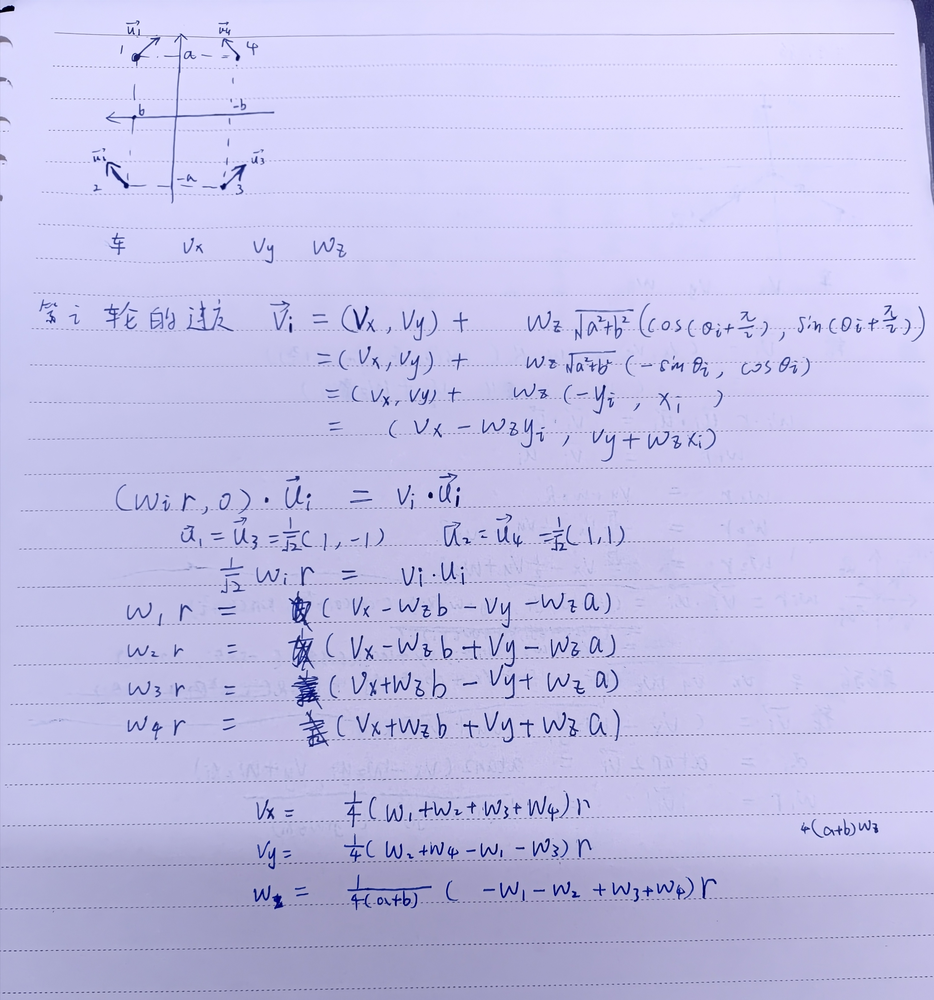
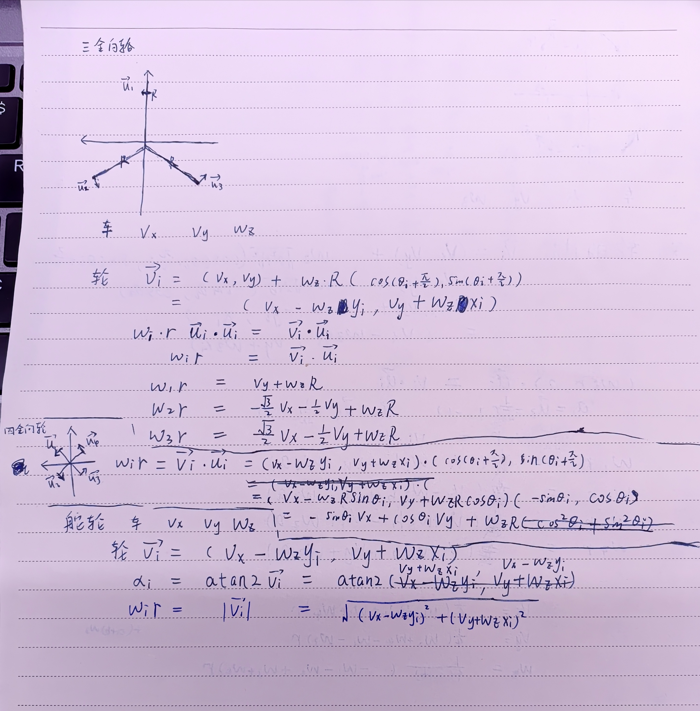
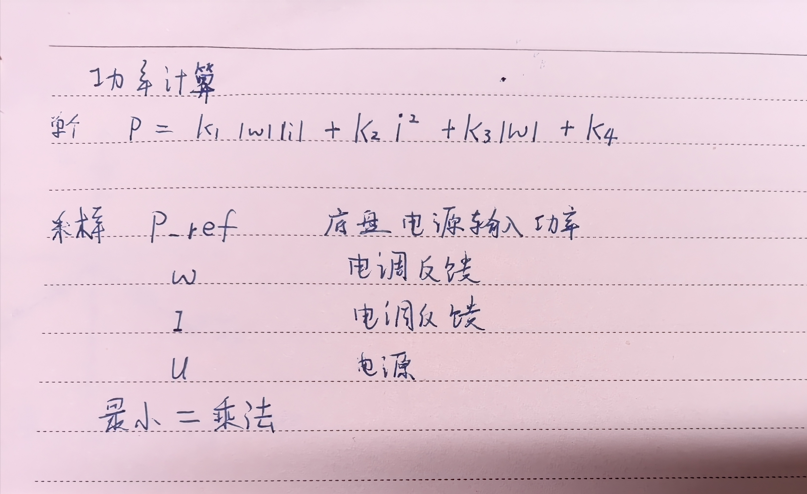

| 构型       | 自由度 | 效率              | 地面要求           | 载重/接触      | 精度 | 成本 | 一句话定位             |
| ---------- | ------ | ----------------- | ------------------ | -------------- | ---- | ---- | ---------------------- |
| 麦克纳姆轮 | 3      | 低（45°滑移损耗） | 高（必须平整干净） | 中低           | 中   | 低   | 平整场地的低成本全向   |
| 全向轮     | 3      | 中                | 高                 | 低（辊子更细） | 中   | 低   | 轻载、小平台、科研     |
| 舵轮       | 3      | 高                | 中                 | 好             | 高   | 高   | 高机动、重载、精准走位 |

半舵半全向

舵轮模块已经能提供全部 3 个自由度的控制力，全向轮更便宜、更省空间

直行效率高，调试难度低，

它的代价也非常明确：侧向力只剩一半，所以它适合"直行为主"的场景，不适合横向对抗。

